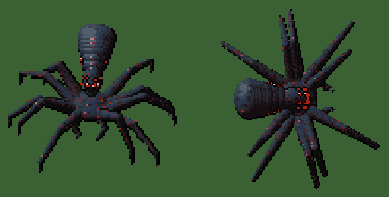

# The Broodmother (concept art)

A planned Hardcore-only boss (D-178). **The game doesn't load anything in this folder yet**: these files keep the
finished art and the script that draws it until she is built.



## Her look

- A small, flat, crab-like body on **ten legs**, five a side, thick at the hip and tapering to needle points.
- Two thin pincers tucked in front.
- A long, smooth **wedge-shaped skull** raised on a short neck behind the body, centred between the hind legs and
  tilted back. It is wider at the back than at the front, glossy, with two ribs near the neck.
- **Flat red spider eyes:** a big front pair and smaller ones behind on the snout, plus a short row of tiny eyes up
  each side of the skull. Pale teeth on the jaw under the snout.
- Pixel art in a fixed palette: slate blue where lit, maroon-black in shadow, scattered red and dusty-pink flecks.
  The outline is drawn only on the shadow side.

It started from a reference sprite the owner shared (a small crab-bodied creature with a raised alien-like head),
redrawn and changed over several rounds of notes.

## Files

| File | What |
|---|---|
| `broodmother_top_idle_4f.png` | Top-down, facing right, idle: 4 frames of 128×128 (breathing, head nod, jaw and pincers) |
| `broodmother_top_run_8f.png` | Top-down, facing right, running: 8 frames of 128×128 (two groups of five legs, lifted strides, bouncing body) |
| `broodmother_side_idle_4f.png` | The raised 3/4 view, idle: 4 frames of 96×96 |
| `broodmother_side_run_8f.png` | The raised 3/4 view, running: 8 frames of 96×96 |
| `preview_idle.gif`, `preview_run.gif` | Both views side by side, looping, for a quick look |
| `broodmother.py` | The script that draws them all |

The strips follow the game's naming (`_4f`, `_8f`: square frames cut by the loader, D-082), so the top-down ones can
move into `src/art/enemies/` when she is built.

## Redrawing

```bash
python3 art/concepts/broodmother/broodmother.py art/concepts/broodmother
```

It needs Python 3 with numpy and Pillow, and rewrites the four strips (plus one PNG per frame in `frames/`, which git
ignores). She is modelled once in 3D, as ellipsoids and chains of spheres, and drawn by two cameras, so both views
always match. The numbers to change are in `spider()`: the head (`axis`, the wedge's widths), the eyes, the pincers
and the legs (`hips`, the leg widths), and the gait (`slide`, `lift`).

## Still to decide before she is built

Her rules: where she lives in Hardcore, her numbers, and whether she drops a brood. The design note proposes the
queen of a far "Lair" nest with 4,000 health and armour 8; those numbers are untested. The game also needs two small
changes to draw her: bugs are drawn at most 2.2 tiles across today, and a bug has walk and attack art but no idle.
