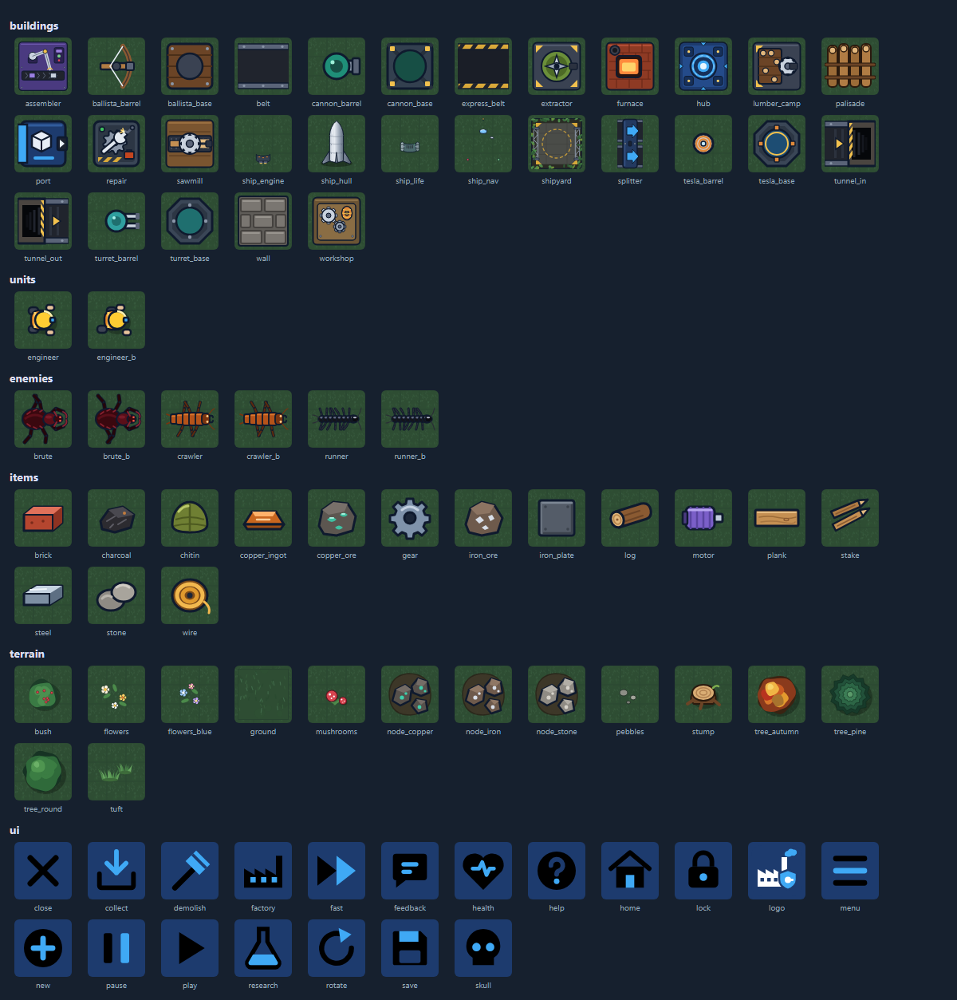

# Art list

Everything the game draws, plus what's needed for launch.

## How art gets into the game

Sprites live in **`src/art/<category>/<name>`** and are loaded automatically.
Every P1 and P2 asset already has a **placeholder SVG** there. To replace one,
add a **PNG with the same name** next to it (for example `src/art/items/gear.png`
beside `gear.svg`). The PNG wins and no code changes are needed. Delete the SVG once you're happy.

Status values: **Placeholder** = an SVG stand-in exists, **Code** = drawn by the
renderer for now (a sprite can replace it later), **Needed** = not in the game
yet, **Final** = your art is in.

**Art review 1 (2026-10-23):** the owner marked 7 sprites to polish and 6 to redraw, all done in 0.27.0. Still to come: bugs of different ages and sizes, and a Hardcore look (more horrifying bugs, nests as mounded holes); the nest plan is D-065.

Open `src/art/*/*.svg` in a browser or vector editor to see the placeholders up close.
They show the intended size, facing and silhouette.

## Specs (for every asset unless noted)

| | |
|---|---|
| **View** | Top-down (straight down). A slight ¾ tilt is fine if it's consistent |
| **Grid** | 1 tile = **64×64 px** at 1×. Please also export **128×128 (@2x)** for phones |
| **Format** | PNG with transparency. Keep layered source files (PSD, Aseprite, Krita…) |
| **Facing** | Directional sprites face **east (right)**; the game rotates them. If the lighting looks wrong rotated, provide all four directions as `_e`, `_s`, `_w`, `_n` |
| **Animation** | A horizontal strip of equal-size frames, with the frame count in the name, e.g. `belt_8f.png`. The loader doesn't read strips yet, so a single frame is the most useful first delivery. The game animates belts, glows and bobbing in code for now. **Exception, enemy walk cycles:** two separate files, `crawler.png` and `crawler_b.png`; the game swaps them as the bug walks |
| **Art direction** | A whimsical forest clearing (D-028): grassy ground, flowers and mushrooms, trees around the edge, fireflies and drifting leaves. The machines stay navy, steel and hazard-yellow, so they stand out from the greenery |
| **Padding** | Building art should leave about 4 px clear at each tile edge, so neighbours read as separate |
| **Naming** | Match the placeholder: `src/art/category/name.png`, e.g. `src/art/items/iron_plate.png` |
| **Palette** | Item colours must stay distinct for colour-blind players. Give each item a distinct **shape** as well |

Priority: **P1** = needed to replace the placeholders in the core loop,
**P2** = the rest of the current game, **P3** = polish and launch.

## Terrain

| Asset | Size | Frames | Priority | Status |
|---|---|---|---|---|
| Ground tile: grass, seamless, with a faint tile edge (3–4 variants so it doesn't look tiled) | 64×64 | 1 | P1 | Placeholder (`terrain/ground`) |
| Map edge: soft shadow where the clearing meets the forest | — | 1 | P3 | Code |
| Iron ore node (2–3 variants), on a dirt patch with a transparent background | 64×64 | 1 | P1 | Placeholder |
| Copper ore node (2–3 variants) | 64×64 | 1 | P1 | Placeholder |
| Stone node (2–3 variants) | 64×64 | 1 | P1 | Placeholder |
| Decorations, transparent: grass tuft, flowers (2 colourways), mushrooms, pebbles. Scattered on empty tiles | 64×64 | 1 | P2 | Placeholder (`terrain/tuft`, `flowers`, `flowers_blue`, `mushrooms`, `pebbles`) |
| Trees, top-down canopies with a soft shadow: round, autumn, pine, berry bush. They fill a band around the map | 128×128 (2 tiles) | 1 | P2 | Placeholder (`terrain/tree_round`, `tree_autumn`, `tree_pine`, `bush`) |
| Map trees (D-044): the same canopies, drawn about 1.4 tiles across on every forest tile. Zoomed far out, a plain canopy colour | — | — | P2 | Uses the tree sprites |
| Tree stump, with a sprouting twig, on a transparent background | 64×64 | 1 | P2 | Placeholder (`terrain/stump`) |
| Fireflies and drifting leaves | — | — | P3 | Code |

## Items

Drawn small on belts (about 20 px on screen) and larger in menus, so they need simple, bold silhouettes.

| Asset | Size | Priority | Status |
|---|---|---|---|
| Iron ore | 32×32 (+64×64 for UI) | P1 | Placeholder |
| Copper ore | 32×32 (+64×64) | P1 | Placeholder |
| Stone | 32×32 (+64×64) | P1 | Placeholder |
| Iron plate (a dark grey, flat square plate) | 32×32 (+64×64) | P1 | Placeholder (redrawn after the art review) |
| Copper ingot | 32×32 (+64×64) | P1 | Placeholder |
| Brick | 32×32 (+64×64) | P1 | Placeholder |
| Gear | 32×32 (+64×64) | P1 | Placeholder |
| Copper wire | 32×32 (+64×64) | P1 | Placeholder |
| Motor | 32×32 (+64×64) | P1 | Placeholder |
| Log | 32×32 (+64×64) | P2 | Placeholder |
| Plank (a long, flat board) | 32×32 (+64×64) | P2 | Placeholder (redrawn after the art review) |
| Stake (a bundle of two sharpened stakes) | 32×32 (+64×64) | P2 | Placeholder |
| Charcoal | 32×32 (+64×64) | P2 | Placeholder |
| Steel (an ingot, cooler and brighter than iron plate) | 32×32 (+64×64) | P2 | Placeholder |

## Buildings

| Asset | Tiles | Notes | Frames | Priority | Status |
|---|---|---|---|---|---|
| Hub | 5×5 (320×320) | Centrepiece. A damaged variant is a nice extra | 1 (+idle loop) | P1 | Placeholder |
| Belt (straight) | 1×1 | Moving surface; must tile seamlessly end to end | 8 | P1 | Placeholder |
| Belt (corner) | 1×1 | Drawn in code (quarter turn, matching the straight sprite's rails). A sprite could replace it | 8 | P3 | Code |
| Belt end cap, join flange | 1×1 | Drawn in code: a hazard bumper where a line stops, a metal flange where a belt meets a building | 1 | P3 | Code |
| Extractor | 2×2 (128×128) | Drill, facing east. The game draws an output port at the middle of the east edge | 4–8 working | P1 | Placeholder |
| Furnace | 2×2 (128×128) | Idle and working (glow), facing east | 1 + 4 | P1 | Placeholder |
| Workshop | 2×2 (128×128) | Idle and working, facing east | 1 + 4 | P2 | Placeholder |
| Assembler | 3×3 (192×192) | Idle and working, facing east | 1 + 4 | P2 | Placeholder |
| Splitter | 1×2 (64×128), facing east | A box straddling two belt lanes, an arrow on each: two lanes in, two out (#34) | 1 | P2 | Placeholder |
| Underground belt entrance | 1×1 | A belt running into a hooded mouth on the east side, diving underground (#35) | 1 | P2 | Placeholder |
| Underground belt exit | 1×1 | A belt coming up out of a hooded mouth on the west side (#35) | 1 | P2 | Placeholder |
| Hub port | 1×1 | Should look like part of the hub, with output to the east | 1 | P2 | Placeholder |
| Turret base | 1×1 | Static | 1 | P1 | Placeholder |
| Turret barrel | 1×1 | Separate layer that rotates to aim; centred pivot | 1 | P1 | Placeholder |
| Cannon base | 1×1 | | 1 | P2 | Placeholder |
| Cannon barrel | 1×1 | Separate layer, as for the turret | 1 | P2 | Placeholder |
| Repair station | 1×1 | A workshop pad: a cog with a spanner across it, a welding arm with sparks, a toolbox | 1 + 4 working | P2 | Placeholder (redrawn after the art review) |
| Shipyard | 3×3 (192×192) | A landing pad under camouflage netting, with gantries | 1 | P2 | Placeholder |
| Ship stages | 3×3 overlays | The ship standing upright on its pad, in a three-quarter view (seen from the front and a little above), drawn stage by stage: `ship_hull`, `ship_engine`, `ship_life`, `ship_nav`. Each overlay holds only its own parts. The game draws engine flames at launch | 1 each | P2 | Placeholder |
| Lumber Camp | 2×2 (128×128) | A log pile and a saw, facing east. The game draws an output port at the middle of the east edge | 1 + 4 working | P2 | Placeholder |
| Sawmill | 2×2 (128×128) | A saw bench, logs in and planks out, facing east | 1 + 4 working | P2 | Placeholder |
| Palisade | 1×1 | Upright logs held by two cross supports, no background. Later a set that joins up, like the wall | 1 | P2 | Placeholder |
| Leaf burst when a tree is cut | 64×64 | 4 | P3 | Code |
| Express belt (straight) | 1×1 | Like the belt, with hazard-yellow rails so it reads as faster. Corners are drawn in code with yellow rails | 8 | P2 | Placeholder (`buildings/express_belt`) |
| Ballista base | 1×1 | A wooden platform | 1 | P2 | Placeholder (`buildings/ballista_base`) |
| Ballista bow | 1×1 | Separate layer that turns to aim: the bow at the front of the stock, string drawn back, no arrow; centred pivot | 1 | P2 | Placeholder (`buildings/ballista_barrel`) |
| Tesla base | 1×1 | Static | 1 | P2 | Placeholder (`buildings/tesla_base`) |
| Tesla coil | 1×1 | Separate layer that turns to aim, like the turret barrel, no arrow; centred pivot | 1 | P2 | Placeholder (`buildings/tesla_barrel`) |
| Tesla lightning | — | A jagged bolt with a glow, redrawn every frame | — | P3 | Code |
| Wall | 1×1 | Single block for now. Later a 16-piece set that joins up with neighbours | 1 | P2 | Placeholder |
| Construction / ghost overlay | 1×1 | Optional: the game can tint sprites instead | 1 | P3 | Optional |

## Units

| Asset | Size on screen | Frames | Priority | Status |
|---|---|---|---|---|
| Engineer (the player character, #40): top-down, facing east; a yellow hard hat, orange overalls, boots | 1 tile (64×64) | 2 walk (`units/engineer`, `engineer_b`) | P1 | Placeholder |

## Enemies

All top-down and facing east. Each has two walk frames (`name` and `name_b`, legs in opposite
tripod poses); the game swaps them as the bug moves, so a bug standing still to attack stops walking.

| Asset | Size on screen | Frames | Priority | Status |
|---|---|---|---|---|
| Crawler: long, flat and segmented, six legs, dark orange | ~28 px (fits a 32×32 frame) | 2 walk (+4 attack later) | P1 | Placeholder (`crawler`, `crawler_b`; redrawn after the art review) |
| Runner: glossy black, centipede-like, many legs | ~22 px (32×32) | 2 walk (+4 attack later) | P2 | Placeholder (`runner`, `runner_b`; redrawn after the art review) |
| Brute: four-legged and centaur-like (no human top): a heavy rear body, a raised front body with two hooked claws; very dark red | ~46 px (64×64) | 2 walk (+4 attack later) | P2 | Placeholder (`brute`, `brute_b`; redrawn after the art review) |
| Young crawler, runner and brute (D-065, planned): smaller, paler versions that grow into the adults | about 60% of the adult | 2 walk each | P2 | Needed |
| Death puff or splat (shared) | 64×64 | 4–6 | P2 | Code |

## Effects

| Asset | Size | Frames | Priority | Status |
|---|---|---|---|---|
| Muzzle flash | 32×32 | 2–3 | P3 | Code |
| Cannon shell | 16×16 | 1 | P3 | Needed |
| Explosion (cannon splash) | 128×128 | 6 | P3 | Code |
| Hit spark | 32×32 | 3 | P3 | Needed |
| Repair sparkle | 32×32 | 4 | P3 | Needed |
| Building destroyed (debris) | 64×64 | 5 | P3 | Needed |
| Nest mound and territory outline | 64×64 mound; outline in code | 1 (+ cleared) | P2 | Code |
| Nest mounds by kind (D-065, planned): crawler warren, runner hive, brute den, queen nest (bigger), each with a damaged look; Hardcore versions as mounded holes | 2×2 tiles (queen 3×3) | 1 + damaged | P2 | Needed |
| Chitin (item, D-065): an olive bug-shell plate | Item size | 1 | P2 | Placeholder (`items/chitin`) |
| Hub breach (shockwave) | 256×256 | 6 | P3 | Code |

## UI

The menus use a flat, two-colour style: navy `#1d3b6e` and sky blue `#3fa9f5`
on white, with bold, rounded silhouettes. Icons are drawn white with one
sky-blue accent shape, on a 24×24 grid. If an icon uses the colour names
`var(--icon-accent, #3fa9f5)` and `var(--icon-ink, #1d3b6e)`, the game can recolour it on highlighted buttons.

| Asset | Size | Priority | Status |
|---|---|---|---|
| App icon master | 1024×1024 (no transparency, for the stores) | P3 | Needed (after naming). Can start from `ui/logo.svg` |
| Favicon / PWA icons | 512×512 and 192×192 | P3 | Placeholder |
| Logo / wordmark | Vector (SVG) | P3 | Placeholder mark `ui/logo.svg`; the wordmark is text for now |
| UI icons (`src/art/ui/`): health, research, pause, play, fast, menu, rotate, demolish, close, save, help, home, new, lock, skull, factory, collect, feedback | 24×24 grid, SVG preferred | P3 | Placeholder |
| Research icons (one per research, 10 today) | 64×64 | P3 | Optional |
| Toolbar building icons | Uses the building sprites; no extra art needed | — | — |

## Audio (not art, but listed so it isn't forgotten)

**Sound effects: done** (synthesized in code, D-043): building placed, belt placed, demolished,
blocked placement, turret shot, cannon shot, hub gun, enemy death, building destroyed, hub hit,
breach, research complete, ship stage, launch, nest provoked, UI click, tree chopped, tesla zap, and a
machine-running hum that follows how busy the factory on screen is. Recorded sounds can replace any of them.

**Music: done.** Nine original tracks in a late-90s adventure style, generated in code: the menu
theme, seven tracks for play and a fanfare for the first delivery (`audio/compose/`, D-051, D-052). See
[GAME_DESIGN.md](GAME_DESIGN.md#music).

## Not needed

- Separate toolbar icons (the building sprites are reused)
- Fonts: Montserrat (SIL Open Font License) loads from Google Fonts for headings; body text uses the system UI font
